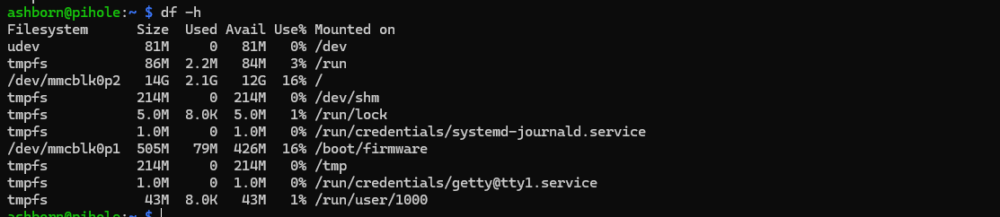
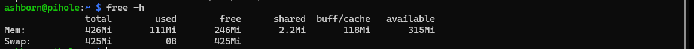
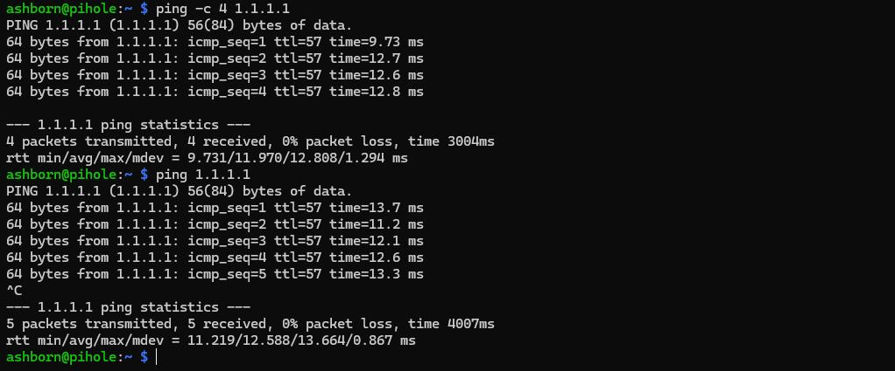
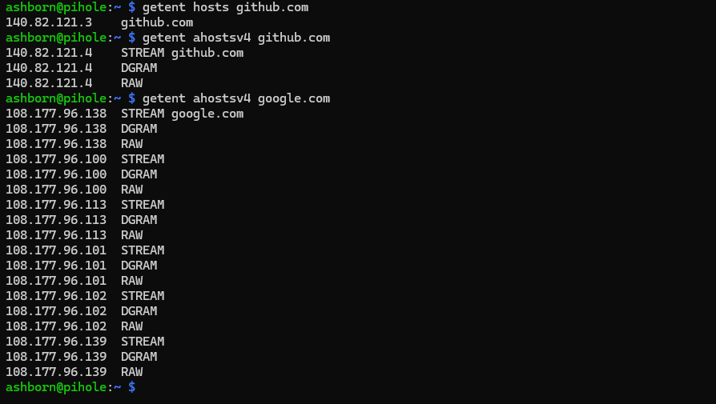

# System Preparation and Verification

## Overview

After installing Raspberry Pi OS Lite and setting up SSH in Milestone 1, I focused on preparing my Raspberry Pi Zero W for Pi-hole.

My goal was to update the operating system, check available resources, and verify network connectivity before installing additional software. This also gave me an opportunity to practice Linux commands and basic networking.

## 1. Updating Raspberry Pi OS

I started by updating the package lists and upgrading the system:

```bash
sudo apt update
sudo apt full-upgrade -y
sudo reboot
```

The initial update showed 23 packages with available upgrades.

After rebooting, I temporarily had trouble reconnecting through the hostname:

```powershell
ssh ashborn@pihole.local
```

I could also connect using the Raspberry Pi's local IP address:

```powershell
ssh ashborn@192.168.0.104
```

This helped me understand the difference between hostname resolution and connecting directly through an IP address.

## 2. Checking Storage and Memory

I checked the Raspberry Pi's storage and memory using:

```bash
df -h /
free -h
```

| Resource | Total | Used | Available |
|---|---|---|---|
| Storage | 14 GB | 2.1 GB | 12 GB |
| RAM | 426 MiB | 111 MiB | 315 MiB |
| Swap | 425 MiB | 0 B | 425 MiB |

Only 16% of the storage was being used, and the system still had approximately 311 MiB of available RAM.

Since the Raspberry Pi Zero W has limited hardware resources, these measurements will serve as a baseline for comparing performance after installing Pi-hole.

### System Resource Verification





## 3. Testing Internet Connectivity

Before installing Pi-hole, I checked whether the Raspberry Pi could communicate with an external server.

```bash
ping -c 4 1.1.1.1
```

The results were:

- 4 packets transmitted and received
- 0% packet loss
- The first test had an average response time of approximately 12 ms, with 0% packet loss.
This confirmed that the Raspberry Pi could reach an external IP address.

### Network Connectivity Test



## 4. Testing DNS Resolution

Since Pi-hole works by filtering DNS requests, I wanted to understand how domain names are resolved into IP addresses.

I started with:

```bash
getent hosts github.com
```

The command successfully returned an IP address for GitHub.

I then explored IPv4 resolution using:

```bash
getent ahostsv4 github.com
getent ahostsv4 google.com
```

During testing, GitHub resolved to both `140.82.121.3` and `140.82.121.4` on different lookups. Google returned six IPv4 addresses in one lookup.

I also noticed that the addresses appeared alongside three socket types: `STREAM`, `DGRAM`, and `RAW`.

These experiments helped me understand that a domain can resolve to multiple IP addresses and that Linux can display address information for different socket types.

Most importantly, the tests confirmed that hostname resolution was working before installing Pi-hole.

### DNS Test Screenshot



## 5. Inspecting Network Configuration

Next, I checked the Raspberry Pi's network configuration:

```bash
ip -4 route
cat /sys/class/net/wlan0/address
```

The results showed:

| Parameter | Value |
|---|---|
| Hostname | pihole |
| Interface | wlan0 (Wi-Fi) |
| Local IP | 192.168.0.104 |
| Gateway | 192.168.0.1 |
| Network | 192.168.0.0/24 |
| IP Assignment | DHCP |

I also identified the Wi-Fi interface's MAC address, which will be useful when configuring a DHCP reservation.

A stable local IP address is important because other devices will eventually use PiGuard as their DNS server.

At this stage, I only inspected the network settings without modifying them.

## 6. What I Learned

This milestone helped me become more comfortable managing a Linux system remotely.

Some of the main things I learned were:

- Updating Linux packages and rebooting through SSH.
- Checking disk storage, RAM, and swap usage.
- Testing connectivity using `ping`.
- Understanding DNS and IPv4 address resolution.
- Recognizing that domains can have multiple IP addresses.
- Identifying the gateway, network interface, and MAC address.
- Understanding why a stable IP address matters for Pi-hole.

I also learned that `ping` and `getent` test different aspects of networking. One checks whether a destination responds, while the other checks hostname resolution.

## 7. Milestone Outcome

By the end of Milestone 2, I had:

- Updated the system and rebooted successfully.
- Verified storage and memory availability.
- Confirmed internet connectivity.
- Tested DNS resolution using GitHub and Google.
- Identified the network settings needed for Pi-hole.

The Raspberry Pi Zero W is now prepared for the next stage of the project.

**Next milestone:** Configure a DHCP reservation, install Pi-hole, and test DNS-based ad blocking.

---

*Project: PiGuard — Raspberry Pi Zero W Network Ad Blocker*

*Milestone 02: Completed — November 2026*
