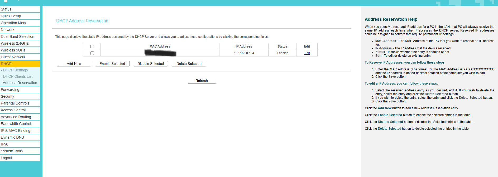
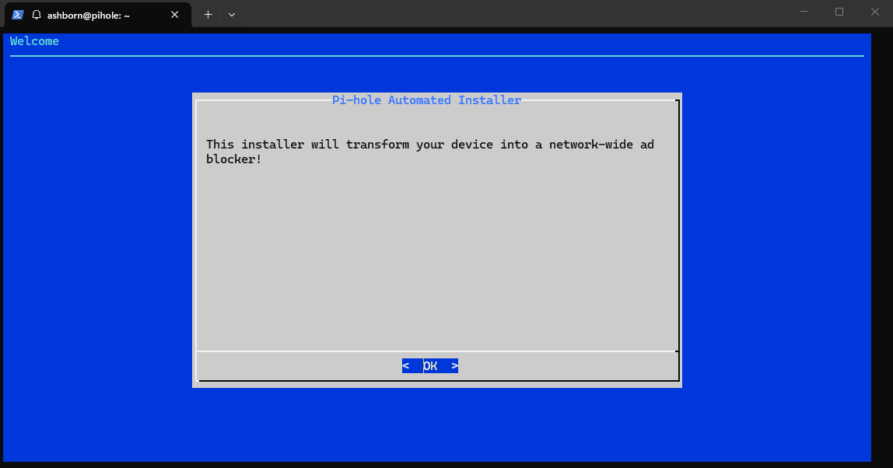
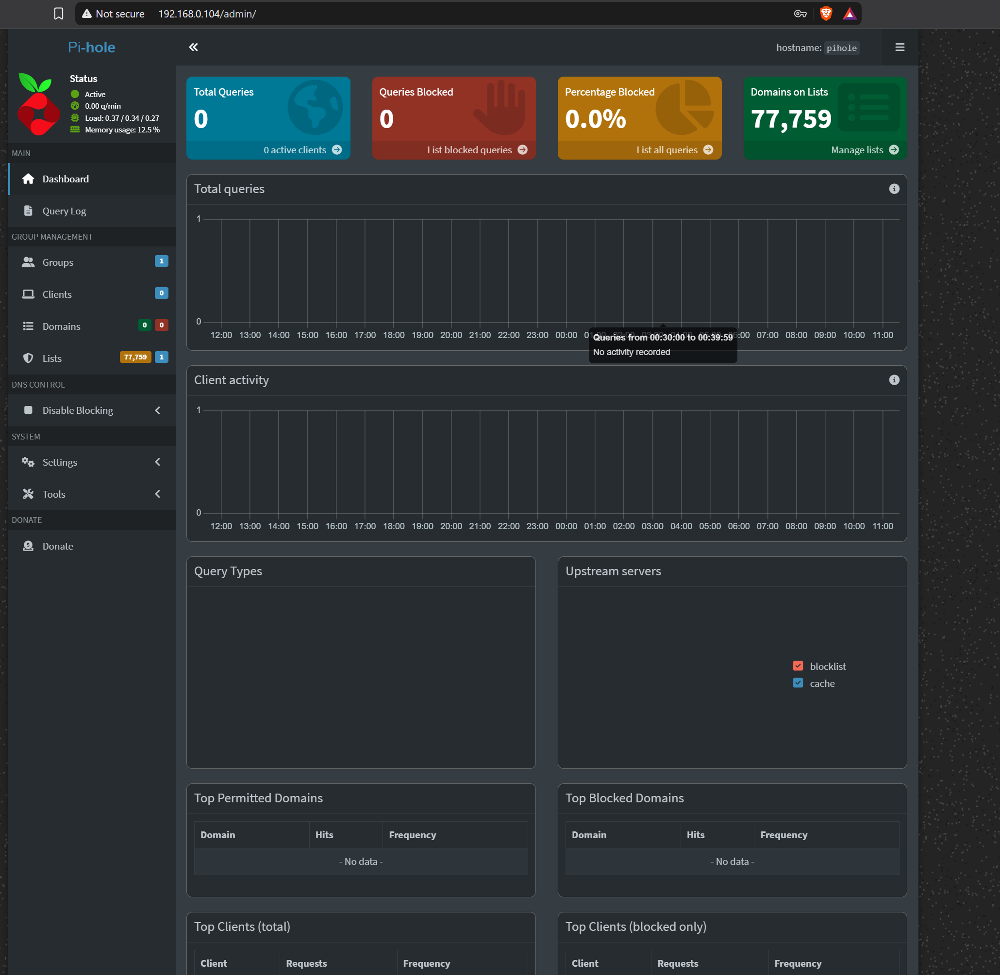
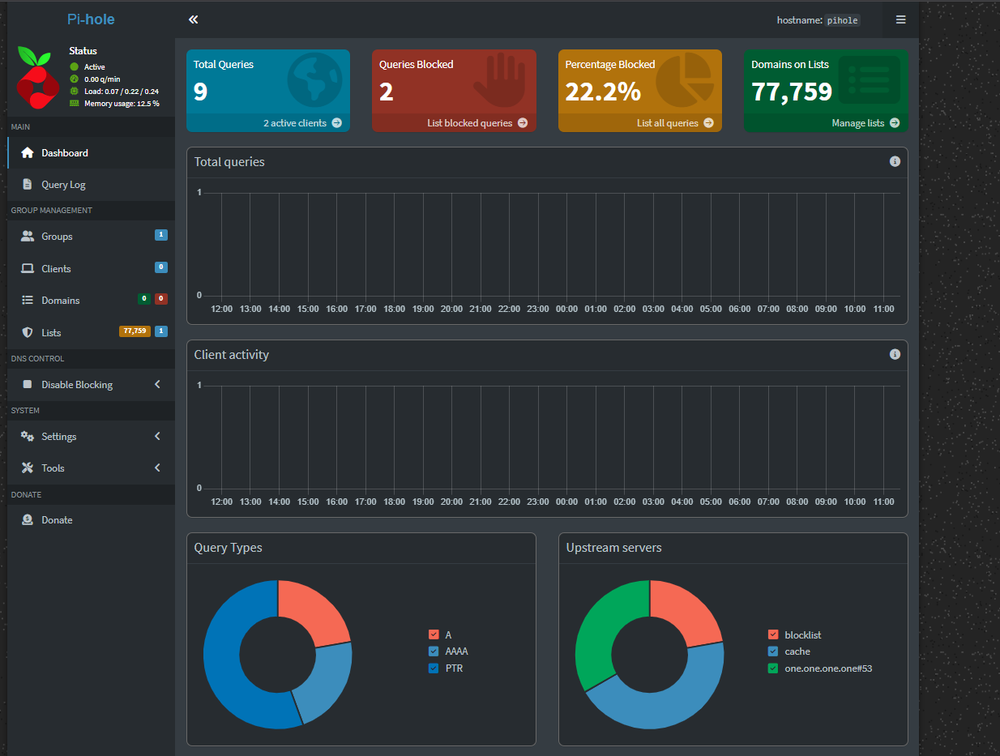
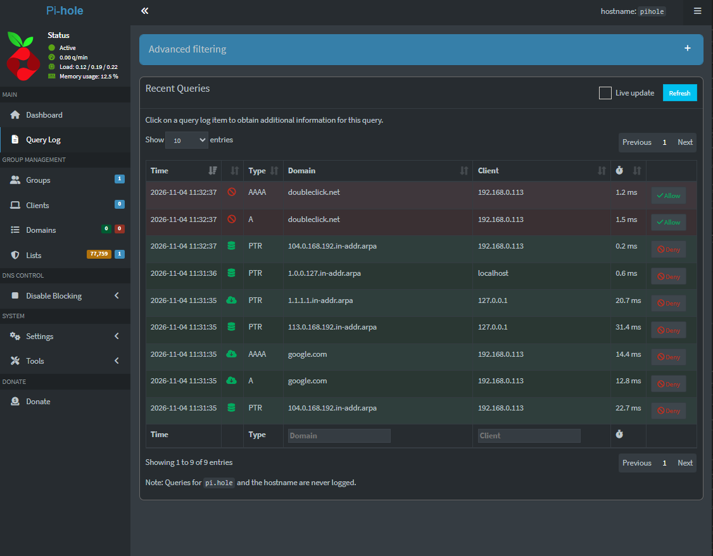

# Pi-hole Installation & DNS Filtering

## Overview

The objective of this step was to configure my Raspberry Pi Zero W as a DNS filtering server using Pi-hole.

I configured a DHCP reservation, installed Pi-hole, selected an upstream DNS provider, and verified DNS resolution and advertisement blocking using Windows PowerShell.

All DNS tests were performed directly against Pi-hole without changing the router's default DNS settings or the Windows PC's DNS configuration.

## 1. DHCP Address Reservation

Pi-hole requires a consistent IP address so that other devices can reliably reach it as a DNS server.

Since DHCP-assigned addresses can change, I configured an address reservation on my TP-Link Archer A5 router under **DHCP → Address Reservation**.



| Parameter | Configuration |
|---|---|
| Hostname | `pihole` |
| Interface | `wlan0` |
| MAC address | `B8:27:XX:XX:XX:XX` |
| Reserved IP | `192.168.0.104` |
| Router IP | `192.168.0.1` |

The router uses the Raspberry Pi's MAC address to identify its network interface and assign the reserved IP.

Verification:

```bash
hostname -I
```

Output:

```text
192.168.0.104
```

**Result:** DHCP reservation configured and IP address verified.

## 2. Preparing and Installing Pi-hole

Pi-hole is open-source DNS filtering software that blocks requests to unwanted domains while forwarding permitted requests to an upstream DNS resolver.

First, I verified that `curl` was installed:

```bash
sudo apt install curl -y
```

The system confirmed that `curl` was already installed.

I then launched the official Pi-hole installer:

```bash
curl -sSL https://install.pi-hole.net | bash
```

The installer detected the Raspberry Pi Zero W's ARMv6 architecture and installed the Pi-hole FTL service.



### Installation configuration

| Setting | Configuration |
|---|---|
| IPv4 address | `192.168.0.104` |
| Upstream DNS | Cloudflare (DNSSEC option) |
| DNS servers | `1.1.1.1`, `1.0.0.1` |
| Blocklist | StevenBlack Unified Hosts |
| Query logging | Enabled |
| Privacy level | 0 — Show everything |
| Pi-hole IPv6 | Not configured |

Cloudflare acts as the upstream DNS provider, resolving permitted domain names when Pi-hole does not already have a cached answer.

The installer successfully downloaded the blocklist:

```text
[✓] Status: Retrieval successful
[✓] Number of gravity domains: 77759
[✓] DNS resolution is available
[✓] Installation complete!
```

**Result:** Pi-hole was installed successfully with 77,759 domains loaded into its filtering database.

## 3. Web Dashboard Configuration

I accessed the Pi-hole administration interface at:

`http://192.168.0.104/admin/`

I configured the administrator password using:

```bash
sudo pihole setpassword
```

The dashboard confirmed that Pi-hole was active and its blocklist was loaded.

The interface provides DNS statistics, query logs, client activity, and filtering controls.



## 4. DNS Resolution and Blocking Tests

To verify Pi-hole's functionality without changing Windows network settings, I performed direct DNS lookups using PowerShell.

### Test 1 — Allowed domain

```powershell
nslookup google.com 192.168.0.104
```

The command explicitly queries Pi-hole at `192.168.0.104`.

Result:

```text
Server:  pi.hole
Address: 192.168.0.104

Non-authoritative answer:
Name: google.com
Addresses: ...
```

Pi-hole returned valid public IPv4 and IPv6 addresses.

**Status: PASS — DNS resolution successful.**

### Test 2 — Blocked Domain

To verify DNS filtering, I queried `doubleclick.net`, an advertising-related domain included in Pi-hole's blocklist.

```powershell
nslookup doubleclick.net 192.168.0.104
```

Output:

```text
Server:  pi.hole
Address: 192.168.0.104

Name:    doubleclick.net
Addresses: ::
           0.0.0.0
```

Instead of returning the domain's public IP addresses, Pi-hole responded with unspecified IPv4 (`0.0.0.0`) and IPv6 (`::`) addresses, confirming that the domain was blocked.

**Result: PASS — DNS filtering successfully blocked the requested domain.**



## 5. Dashboard and Query Log Verification

After running the tests, I inspected the Pi-hole dashboard and Query Log.

| Metric | Result |
|---|---:|
| Total DNS queries | 9 |
| Blocked queries | 2 |
| Blocking percentage | 22.2% |
| Domains on blocklist | 77,759 |

These statistics represent the initial test session.

The Query Log confirmed:

| Domain | Query type | Status |
|---|---|---|
| `google.com` | A / AAAA | Allowed |
| `doubleclick.net` | A / AAAA | Blocked |

`A` records resolve IPv4 addresses, while `AAAA` records resolve IPv6 addresses.

The queries originated from the Windows client at `192.168.0.113`.



## 6. Outcome and Key Learnings

PiGuard successfully passed its initial DNS resolution and filtering tests.

Through this step, I gained practical experience with DHCP reservations, MAC addressing, DNS resolution, upstream DNS providers, Linux software installation, and network troubleshooting using `nslookup`.

The Raspberry Pi is now functioning as a DNS filtering server, although it has not yet been configured as the default DNS server for other devices.

## Next Steps

- Configure a Windows PC to use PiGuard as its default DNS server.
- Verify filtering during normal web browsing.
- Monitor DNS activity and system reliability.
- Evaluate network-wide deployment after successful testing.
