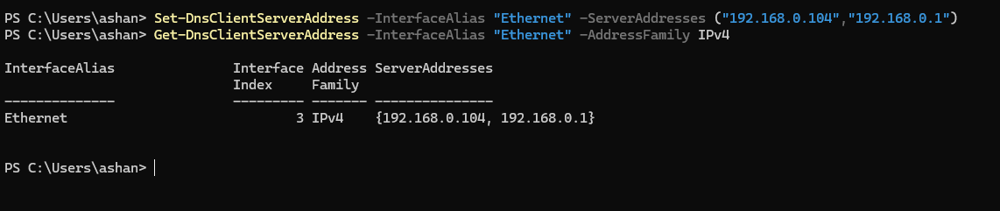
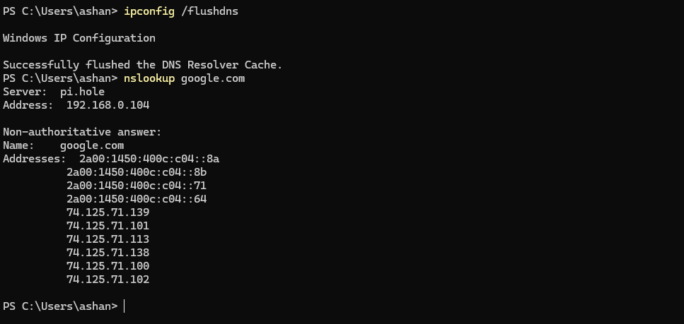
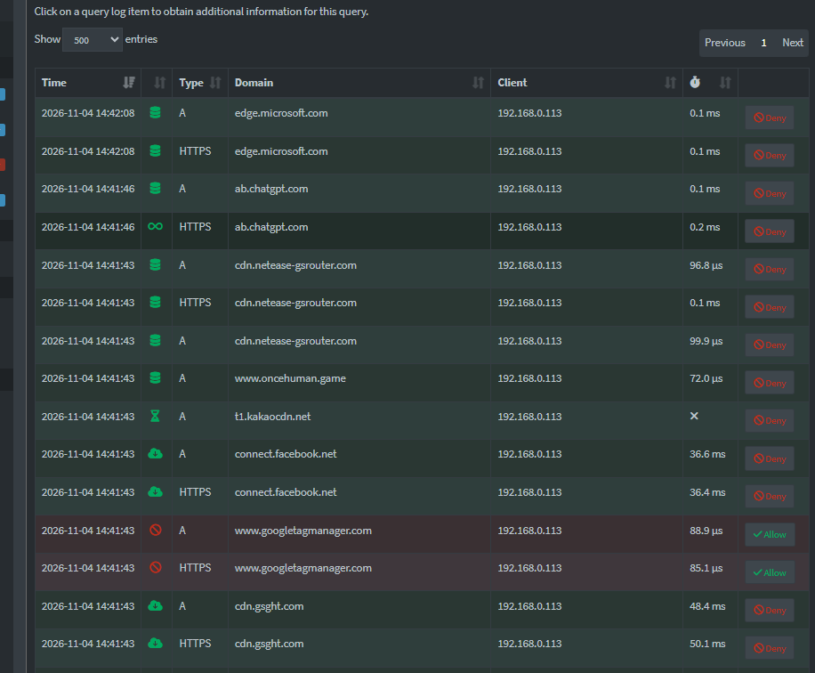
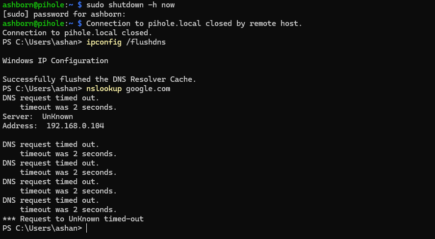
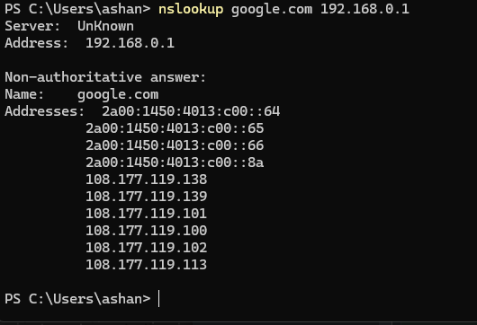
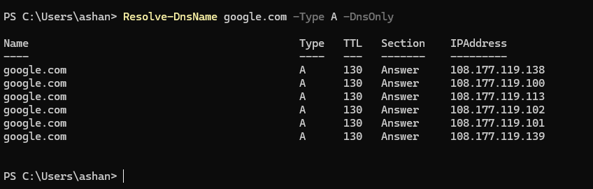
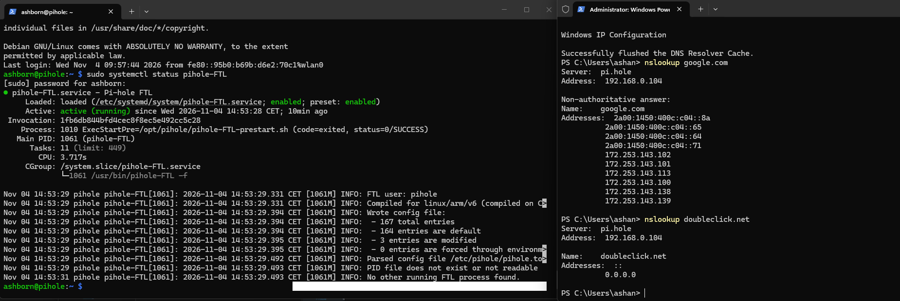

# Single-Device DNS Deployment & Failover Testing

## Overview

The objective was to configure my Windows PC to use PiGuard as its preferred DNS server, verify DNS filtering during normal browsing, and evaluate DNS availability when the Raspberry Pi Zero W goes offline.

DNS requests were now routed through the Windows network configuration rather than manually specifying PiGuard for each lookup.

## 1. Configuring Windows DNS

I first inspected the existing DNS configuration using PowerShell:

```powershell
Get-DnsClientServerAddress -AddressFamily IPv4
```

The Ethernet interface was initially configured to use my TP-Link router (`192.168.0.1`) as its DNS server.

I then configured two DNS servers:

```powershell
Set-DnsClientServerAddress -InterfaceAlias "Ethernet" -ServerAddresses ("192.168.0.104","192.168.0.1")
```

| DNS server | IP address | Purpose |
|---|---|---|
| PiGuard | `192.168.0.104` | Preferred DNS filtering server |
| TP-Link router | `192.168.0.1` | Alternate DNS server |

I verified the configuration:

```powershell
Get-DnsClientServerAddress -InterfaceAlias "Ethernet" -AddressFamily IPv4
```

Both DNS addresses appeared in the Ethernet interface configuration.



**Note:** Windows does not guarantee strict primary-to-secondary DNS failover. The alternate server may occasionally be used even while PiGuard is available.

## 2. Verifying DNS Resolution and Filtering

After clearing the Windows DNS cache:

```powershell
ipconfig /flushdns
```

I performed a DNS lookup without specifying a server:

```powershell
nslookup google.com
```

The response identified PiGuard:

```text
Server:  pi.hole
Address: 192.168.0.104
```

This confirmed that Windows automatically selected PiGuard for the lookup.

I then tested DNS filtering:

```powershell
nslookup doubleclick.net
```

PiGuard returned unspecified IPv4 (`0.0.0.0`) and IPv6 (`::`) addresses, confirming that the advertising-related domain was blocked.



**Result: PASS — DNS resolution and filtering were successful.**

## 3. Real-World Browsing Verification

I tested PiGuard during normal web browsing while monitoring the Pi-hole dashboard.

The Query Log showed DNS requests originating from my Windows PC (`192.168.0.113`), including permitted and blocked requests.

For example, `www.googletagmanager.com` was blocked, while legitimate domains such as `chatgpt.com` were resolved successfully.



This demonstrated that PiGuard was actively processing DNS traffic during normal internet usage.

## 4. Testing DNS Availability During Shutdown

To evaluate reliability, I safely shut down the Raspberry Pi:

```bash
sudo shutdown -h now
```

After flushing the Windows DNS cache, I executed:

```powershell
nslookup google.com
```


The request timed out because `nslookup` continued querying the unavailable PiGuard server.

I then queried the router directly:

```powershell
nslookup google.com 192.168.0.1
```


The router successfully returned valid IP addresses.

To test DNS resolution through the Windows DNS client, I executed:

```powershell
Resolve-DnsName google.com -Type A -DnsOnly
```


This command successfully returned IPv4 addresses while PiGuard was offline.

**Result:** Windows DNS resolution remained functional during the outage, consistent with the availability of the alternate DNS server. The test did not establish strict failover behavior.

## 5. Automatic Recovery After Restart

After reconnecting power, the Raspberry Pi automatically booted and reconnected to Wi-Fi.

I verified SSH access and checked the Pi-hole service:

```bash
sudo systemctl status pihole-FTL
```

The service reported:

```text
Active: active (running)
```

Finally, I cleared the Windows DNS cache and performed another lookup:

```powershell
ipconfig /flushdns
nslookup google.com
```

Windows once again selected:

```text
Server:  pi.hole
Address: 192.168.0.104
```



**Result: PASS — PiGuard recovered automatically and resumed DNS resolution without manual reconfiguration.**

## 6. Results and Key Learnings

| Test | Result |
|---|---|
| Dual DNS configuration | PASS |
| Automatic PiGuard DNS selection | PASS |
| DNS-based domain blocking | PASS |
| Real-world browsing and filtering | PASS |
| Direct router DNS during outage | PASS |
| Windows DNS resolution during outage | PASS |
| Automatic Pi-hole service recovery | PASS |
| DNS resolution through PiGuard after restart | PASS |

This implementation provided practical experience with Windows DNS configuration, DNS server selection, network troubleshooting, service availability, and recovery testing.

It also demonstrated the distinction between DNS resolution through a preferred server and the availability of an alternate resolver.

## Next Steps

- Extend PiGuard DNS filtering to additional devices.
- Improve power reliability for continuous operation.
- Investigate stricter DNS failover and redundancy.
- Monitor DNS performance and long-term stability.
